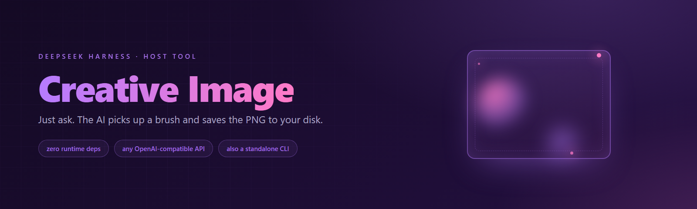

<div align="center">



# 🎨 dsh-creative-plugin

**Give the AI inside DSH a paintbrush. Say "draw me a …" and it handles the rest.**

**English** · [简体中文](./README.md)

[](./LICENSE)
[](./package.json)
[](./package.json)
[](https://github.com/deepseek-ai)

</div>

---

## The 30-second version

**Before:** the AI can only write text. Ask it to draw something and it says it can't.

**After:** it gains one tool, `creative_generate_image`. You just talk to it:

> "Draw a bamboo grove in ink-wash style, rice-paper background."
>
> "Generate a pixel-art game character icon, transparent background."
>
> "Make a Nordic-minimal coffee-shop sign illustration, 16:9."

It organises the prompt, calls an external text-to-image endpoint, **actually saves the PNG to your disk**, and tells you where the file is.

**No commands to memorise, no API to learn.**

> 💡 Bonus: the core script `lib/gen.mjs` also works **as a standalone CLI** — you can generate images without installing DSH at all (see [CLI usage](#cli-usage-works-without-dsh)).

---

## Install

### Option 1: straight from GitHub (recommended)

```bash
dsh plugin --profile web add github:xiaohuo130/dsh-creative-plugin -w
```

### Option 2: clone, then install from a local path

```bash
git clone https://github.com/xiaohuo130/dsh-creative-plugin.git
cd dsh-creative-plugin
dsh plugin --profile web add link:<absolute-path-of-the-clone> -w
```

> 📌 **Restart DSH** afterwards (client patches load at startup), then use it in a new session.

### Requirements

| Item | Requirement |
| --- | --- |
| Node.js | ≥ 18 (uses built-in `fetch`, **zero third-party deps**) |
| DSH | ≥ 0.1.2 (0.2.x works too) |
| Image service | your own **API key** |

---

## Configure the API key

The plugin looks for the key in this order:

1. Environment variable `STEPFUN_API_KEY`
2. `STEPFUN_API_KEY` inside `~/.dsh/.credentials.yaml`

```powershell
# Windows PowerShell (current window only)
$env:STEPFUN_API_KEY = 'sk-xxxx'
```

```yaml
# Or put it in ~/.dsh/.credentials.yaml
STEPFUN_API_KEY: sk-xxxx
```

> ⚠️ Bring your own key. **Never commit it**, and never post screenshots that contain it.

---

## Tool parameters (`creative_generate_image`)

| Parameter | Required | Description | Default |
| --- | --- | --- | --- |
| `prompt` | ✅ | Image prompt (English descriptions usually work better) | — |
| `out` | — | Local output path for the PNG | `~/Pictures/dsh-creative/creative-<timestamp>.png` |
| `model` | — | Image model id | `step-image-edit-2` |
| `baseUrl` | — | Image endpoint base URL (**without** `/images/generations`) | `https://api.stepfun.com/step_plan/v1` |

On success:

```json
{
  "ok": true,
  "message": "Image generated: C:\\Users\\me\\Pictures\\dsh-creative\\creative-2026-10-11T13-20-05.png",
  "path": "...",
  "logs": "IMAGE_BYTES: 1234567\nSAVED: ...\nDONE"
}
```

On failure: `{ "ok": false, "message": "...", "error": { ... "stderr": "..." } }` — `stderr` carries the raw message from the underlying script (e.g. `API_ERROR 401 {...}`), which is what you want when debugging.

---

## CLI usage (works without DSH)

```bash
# Generate and save to a specific path
node lib/gen.mjs --prompt "a red apple on a wooden table, photo" --out ./out.png

# Read the prompt from a file (good for long prompts)
node lib/gen.mjs --prompt-file prompt.txt --out ./out.png

# Switch provider: any OpenAI-compatible /images/generations works
node lib/gen.mjs --prompt "cat in space" --base-url https://api.example.com/v1 \
  --model your-image-model --out ./cat.png
```

| Flag | Description | Default |
| --- | --- | --- |
| `--prompt <text>` | Prompt (mutually exclusive with `--prompt-file`) | — |
| `--prompt-file <file>` | Read the prompt from a UTF-8 file | — |
| `--out <path>` | Where to save the PNG; omit to print the byte count only | do not save |
| `--model <id>` | Image model id | `step-image-edit-2` |
| `--base-url <url>` | Endpoint base URL (without `/images/generations`) | `https://api.stepfun.com/step_plan/v1` |

---

## How it works

```
You say "draw me a ..."
      ↓
DSH session → tool creative_generate_image (lib/index.js)
      ↓  spawns a child process (execFile, argv array, no shell)
node lib/gen.mjs --prompt ... --out ...
      ↓  POST <base-url>/images/generations
{ model, prompt, response_format: "b64_json", text_mode: true, cfg_scale: 1.0, steps: 8 }
      ↓  read data[0].b64_json
base64-decode → write the PNG file
```

- It only relies on the standard `POST /images/generations` (OpenAI-compatible), so **any service exposing that endpoint works**.
- Besides `model` / `prompt` / `response_format`, the body carries StepFun tuning fields (`text_mode` / `cfg_scale` / `steps`). If another provider rejects them as unknown parameters, just edit the request body in `lib/gen.mjs`.
- If the service returns an image URL instead of base64, the script fails loudly with `NO_B64_JSON in response` — no silent success.

---

## FAQ

<details>
<summary><b>I get <code>STEPFUN_API_KEY not found</code></b></summary>

The key isn't reaching the process. The usual culprit: it was set in a shell window **before DSH started** — on Windows those variables do not propagate to an already-running DSH. Restart DSH, or use `~/.dsh/.credentials.yaml` (less error-prone).
</details>

<details>
<summary><b>I get <code>API_ERROR 401</code> / <code>403</code></b></summary>

Invalid key, or the key has no access to that model.
</details>

<details>
<summary><b>I get <code>NO_B64_JSON in response</code></b></summary>

That service/plan does not return base64. Switch to a model or provider that supports `response_format: "b64_json"`.
</details>

<details>
<summary><b>Where is the image saved?</b></summary>

Default `~/Pictures/dsh-creative/creative-<timestamp>.png`; pass `out` to choose any path. The tool's `path` field is the actual location.
</details>

<details>
<summary><b>Can it do image-to-image / reference images?</b></summary>

No. This plugin targets `POST /images/generations` (**text-only**). Image-to-image requires `POST /images/edits` (multipart upload of the reference image). Important: the `generations` endpoint **silently ignores** an `image` field — don't waste time on that route.
</details>

---

## Layout

```
dsh-creative-plugin/
├── package.json        # plugin manifest (dsh.bundle / dsh.client / exports)
├── cordis.patch.yml    # Cordis patch declaration (mounts the plugin into a profile)
├── lib/
│   ├── index.js        # host entry: registers the creative_generate_image tool
│   ├── client.js       # web client entry shell
│   └── gen.mjs         # ★ generation core: HTTP call + save, zero deps, usable as a CLI
├── docs/images/        # README artwork
├── LICENSE             # MIT
└── README.md
```

---

## Changelog

- **0.2.0**
  - `lib/index.js` now actually registers the host tool **`creative_generate_image`** (0.1.0's entry was an empty shell — installing it did nothing)
  - `gen.mjs` resolves its path **relative to the module**, no longer hard-coded to `~/.dsh/plugins/...`
  - Default output directory is now the generic `~/Pictures/dsh-creative/`
  - Switched to `execFileSync(process.execPath, argv)`; no more hand-built shell strings
  - `package.json`: dropped the removed `@deepseek-ai/dsh-client-runtime` dependency; added `license` / `repository` / `keywords` / `files`
  - README rewritten: parameter table, CLI usage, response shape and FAQ
- **0.1.0** first release (`gen.mjs` CLI generation only)

---

## License

[MIT](./LICENSE) © xiaohuo130

<div align="center">

If it saved you an afternoon of wiring APIs, a ⭐ is appreciated.

</div>
