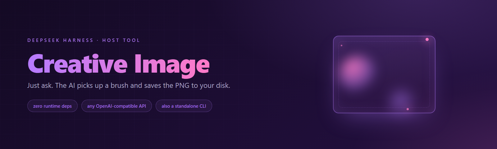

<div align="center">



# 🎨 dsh-creative-plugin

**让 DSH 里的 AI 会画画。你只要说「帮我画一张……」，剩下的它自己办。**

[简体中文](./README.md) · [English](./README.en.md)

[](./LICENSE)
[](./package.json)
[](./package.json)
[](https://github.com/deepseek-ai)

</div>

---

## 30 秒看懂

装上它之前：AI 只会写字，你让它「画个东西」，它只能告诉你它画不了。

装上它之后：AI 多了一个工具 `creative_generate_image`。你正常的说话就行——

> 「帮我画一张水墨风格的竹子，宣纸背景」
>
> 「生成一个像素风游戏角色图标，透明背景」
>
> 「画一张北欧极简风的咖啡店招牌插画，16:9」

它会自己组织提示词、调用外部文生图接口、把 PNG **真的存到你电脑上**，然后告诉你文件在哪。

**你不用记命令，也不用懂 API。**

> 💡 额外好处：负责生图的核心脚本 `lib/gen.mjs` 也能**单独当命令行工具用**，不装 DSH 一样能出图（见 [命令行用法](#命令行用法不装-dsh-也能用)）。

---

## 安装

### 方式一：从 GitHub 装（推荐）

```bash
dsh plugin --profile web add github:xiaohuo130/dsh-creative-plugin -w
```

### 方式二：克隆后按本地目录装

```bash
git clone https://github.com/xiaohuo130/dsh-creative-plugin.git
cd dsh-creative-plugin
dsh plugin --profile web add link:<克隆到的绝对路径> -w
```

> 📌 装完**重启 DSH**（客户端补丁在启动时加载），新会话里就能用了。

### 环境要求

| 项目 | 要求 |
| --- | --- |
| Node.js | ≥ 18（脚本用内置 `fetch`，**零第三方依赖**） |
| DSH | ≥ 0.1.2（0.2.x 也可以） |
| 生图服务 | 需要你自己的 **API Key** |

---

## 配置 API Key

插件按这个顺序找 Key，找到就用：

1. 环境变量 `STEPFUN_API_KEY`
2. `~/.dsh/.credentials.yaml` 里的 `STEPFUN_API_KEY`

```powershell
# Windows PowerShell（只在当前窗口生效）
$env:STEPFUN_API_KEY = 'sk-xxxx'
```

```yaml
# 或者写进 ~/.dsh/.credentials.yaml
STEPFUN_API_KEY: sk-xxxx
```

> ⚠️ Key 请自备。**不要提交到仓库**，也不要把带 Key 的截图发出去。

---

## 工具参数（`creative_generate_image`）

| 参数 | 必填 | 说明 | 默认值 |
| --- | --- | --- | --- |
| `prompt` | ✅ | 图片提示词（英文描述通常效果更好） | — |
| `out` | — | 输出 PNG 的本地路径 | `~/Pictures/dsh-creative/creative-<时间戳>.png` |
| `model` | — | 图像模型名 | `step-image-edit-2` |
| `baseUrl` | — | 图像服务地址（**不含** `/images/generations`） | `https://api.stepfun.com/step_plan/v1` |

成功时返回：

```json
{
  "ok": true,
  "message": "Image generated: C:\\Users\\me\\Pictures\\dsh-creative\\creative-2026-10-11T13-20-05.png",
  "path": "...",
  "logs": "IMAGE_BYTES: 1234567\nSAVED: ...\nDONE"
}
```

失败时返回 `{ "ok": false, "message": "...", "error": { ... "stderr": "..." } }`，其中 `stderr` 是底层脚本打印的原始错误（例如 `API_ERROR 401 {...}`），排障直接看它。

---

## 命令行用法（不装 DSH 也能用）

```bash
# 直接出图，保存到指定路径
node lib/gen.mjs --prompt "a red apple on a wooden table, photo" --out ./out.png

# 从文件读提示词（适合长提示词）
node lib/gen.mjs --prompt-file prompt.txt --out ./out.png

# 换服务：任何 OpenAI 兼容的 /images/generations 都能用
node lib/gen.mjs --prompt "cat in space" --base-url https://api.example.com/v1 \
  --model your-image-model --out ./cat.png
```

| 参数 | 说明 | 默认值 |
| --- | --- | --- |
| `--prompt <文本>` | 提示词（与 `--prompt-file` 二选一） | — |
| `--prompt-file <文件>` | 从 UTF-8 文件读取提示词 | — |
| `--out <路径>` | PNG 保存路径；不传则只打印字节数、不落盘 | 不保存 |
| `--model <模型名>` | 图像模型名 | `step-image-edit-2` |
| `--base-url <地址>` | 服务地址（不含 `/images/generations`） | `https://api.stepfun.com/step_plan/v1` |

---

## 原理

```
你说「画一张 XXX」
      ↓
DSH 会话 → 工具 creative_generate_image（lib/index.js）
      ↓  以子进程方式调用（execFile，参数走数组，不经 shell）
node lib/gen.mjs --prompt ... --out ...
      ↓  POST <base-url>/images/generations
{ model, prompt, response_format: "b64_json", text_mode: true, cfg_scale: 1.0, steps: 8 }
      ↓  取响应 data[0].b64_json
base64 解码 → 写入 PNG 文件
```

- 只依赖标准的 `POST /images/generations`（OpenAI 兼容），所以**任何提供这个接口的服务都能接**。
- 请求体里除 `model` / `prompt` / `response_format` 外的字段（`text_mode` / `cfg_scale` / `steps`）是 StepFun 的调优参数。换别家如果报「未知参数」，直接编辑 `lib/gen.mjs` 里的请求体即可。
- 如果服务返回的是图片 URL 而不是 base64，脚本会明确报 `NO_B64_JSON in response`，不会静默失败。

---

## 常见问题

<details>
<summary><b>调用工具报 <code>STEPFUN_API_KEY not found</code>？</b></summary>

Key 没配到。注意看**是不是配在了「启动 DSH 的那个进程」里**——Windows 下在一个旧窗口设的环境变量，不会传给已经启动的 DSH。要么重启 DSH，要么改用 `~/.dsh/.credentials.yaml`（更省心）。
</details>

<details>
<summary><b>报 <code>API_ERROR 401</code> / <code>403</code>？</b></summary>

Key 无效，或者这个 Key 没有该模型的权限。
</details>

<details>
<summary><b>报 <code>NO_B64_JSON in response</code>？</b></summary>

该服务/套餐不返回 base64。换一个支持 `response_format: "b64_json"` 的模型或服务。
</details>

<details>
<summary><b>图片存哪了？</b></summary>

默认 `~/Pictures/dsh-creative/creative-<时间戳>.png`；调用时传 `out` 可以指定任意路径。工具返回里的 `path` 字段就是实际位置。
</details>

<details>
<summary><b>能做图生图 / 指定参考图吗？</b></summary>

不能，本插件走的是 `POST /images/generations`（**纯文生图**）。图生图必须走 `POST /images/edits`（multipart 上传参考图）。特别注意：`generations` 接口即使你传了 `image` 字段，也会被**静默忽略**——别在这条路上浪费时间。
</details>

---

## 目录结构

```
dsh-creative-plugin/
├── package.json        # 插件清单（dsh.bundle / dsh.client / exports）
├── cordis.patch.yml    # Cordis 补丁声明（把插件挂进 profile）
├── lib/
│   ├── index.js        # 服务端入口：注册 creative_generate_image 工具
│   ├── client.js       # Web 客户端入口壳
│   └── gen.mjs         # ★ 生图核心：调接口 + 落盘，零依赖，可独立当 CLI
├── docs/images/        # 页面配图
├── LICENSE             # MIT
└── README.md
```

---

## 更新日志

- **0.2.0**
  - `lib/index.js` 真正注册宿主工具 **`creative_generate_image`**（0.1.0 的入口只是空壳，装上也用不了）
  - `gen.mjs` 路径改为**按模块相对位置解析**，不再写死 `~/.dsh/plugins/...`
  - 默认输出目录改为通用的 `~/Pictures/dsh-creative/`
  - 改用 `execFileSync(process.execPath, argv)`，去掉拼 shell 字符串
  - `package.json`：移除已被官方删除的 `@deepseek-ai/dsh-client-runtime` 依赖，补 `license` / `repository` / `keywords` / `files`
  - README 重写：补全参数表、命令行用法、返回体与常见问题
- **0.1.0** 首个版本（`gen.mjs` 命令行生图可用）

---

## 许可

[MIT](./LICENSE) © xiaohuo130

<div align="center">

如果它帮你省下了写脚本调接口的时间，欢迎点个 ⭐

</div>
